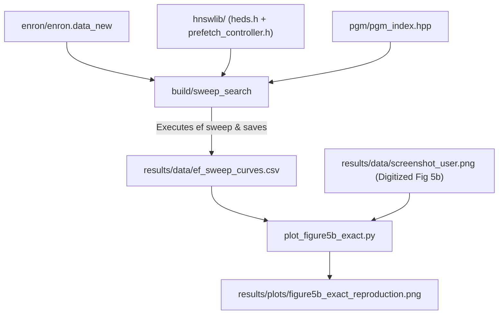

# Repository Tour & Directory Structure: SHG-Index with Prefetching

This document provides a complete, file-by-file directory guide to the codebase. It details where every component lives, what each file does, and how the modules interact.

---

## 1. High-Level Directory Map

```
SHG-Index/
├── CMakeLists.txt                      # Main CMake build configuration
├── README.md                           # Original repository overview
├── GUIDE_EXECUTION_AND_IDEAS.md        # Comprehensive execution & concepts guide
├── PROJECT_DIRECTORY_STRUCTURE.md      # This file: complete repository tour
├── p3518-chen.pdf                      # Original VLDB 2024 paper (Chen et al.)
├── p3518-chen.md                       # Markdown transcript of the SHG paper
├── skip_aware_cluster_prefetching_SHG.md # Design proposal for prefetching
│
├── hnswlib/                            # Core C++ header-only ANNS engine
│   ├── heds.h                          # Core SHG algorithm (Hierarchical Graph + Shortcuts)
│   ├── hnswalg.h                       # Standard HNSW graph implementation
│   ├── prefetch_controller.h           # Modular controller for hardware prefetching
│   ├── cluster_prefetcher.h            # Cluster-aware prefetch routines
│   ├── basis.h                         # Data loading, vector representation & path resolution
│   ├── space_l2.h                      # Euclidean L2 distance space
│   ├── space_ip.h                      # Inner Product distance space
│   ├── visited_list_pool.h             # Fast visited-set bitmask/tag pool
│   └── ...                             # Supporting utility headers
│
├── pgm/                                # PGM-Index: Piecewise Geometric Model learned index
│   ├── pgm_index.hpp                   # Core learned index segments for shortcuts
│   ├── pgm_index_dynamic.hpp           # Dynamic PGM index support
│   └── ...                             # PGM helper utilities
│
├── examples/cpp/                       # Benchmark and search executables
│   ├── example_search.cpp              # Single-run search benchmark
│   └── sweep_search.cpp                # Multi-configuration efSearch sweep harness
│
├── enron/                              # Benchmark dataset: Enron (95K vectors, 1,369-dim)
│   ├── enron.data_new                  # Base vectors in binary float format (~521 MB)
│   ├── enron_query.txt                 # 200 query vectors
│   └── enron_20_groundtruth.txt        # Ground truth nearest neighbors (K=20)
│
├── results/                            # Cleanly partitioned benchmark outputs
│   ├── data/                           # Raw measured benchmark data (CSVs & logs)
│   │   ├── ef_sweep_curves.csv         # Full ef parameter sweep data across methods
│   │   ├── enron_heds_K20_baseline_queries.txt # Per-query metrics for Baseline SHG
│   │   ├── enron_heds_K20_step1_skip_prefetch_queries.txt
│   │   ├── enron_heds_K20_step2_skip_lookahead_prefetch_queries.txt
│   │   ├── enron_heds_K20_step3_cluster_prefetch_queries.txt
│   │   ├── strictly_measured_benchmark.csv # Summary table of all 4 methods
│   │   ├── screenshot_user.png         # Reference screenshot of Figure 5b
│   │   └── fig5b_from_pdf.png          # High-resolution Figure 5b from PDF
│   │
│   └── plots/                          # Generated high-resolution visualization plots
│       ├── figure5b_exact_reproduction.png # 4-panel exact reproduction of Figure 5b
│       ├── measured_benchmark_comparison.png # Latency percentiles & QPS comparison
│       └── user_screenshot_view.png    # Visual verification artifact
│
└── Python Scripts/                     # Plotting and analysis tools (in root)
    ├── plot_figure5b_exact.py          # Generates Figure 5b reproduction & speedup curves
    ├── plot_measured_results.py        # Generates latency distribution & percentiles
    └── plot_search_performance.py      # Latency CDF generator
```

---

## 2. Directory Breakdown

### `hnswlib/` (The Core Graph Engine)
Contains the C++ header library powering the hierarchical graph index and our hardware prefetching extensions:

- **`heds.h`**: The heart of the SHG implementation.
  - Implements `HEDS<dist_t>`, which extends HNSW with multi-level dimension-reduced vector representations (`data_rep_memory_`) and learned shortcuts.
  - Line 614: `size_t ef_search = std::max(ef_, (size_t)query.k);` allows dynamic `efSearch` beam-width scaling.
  - Line 600: Injects `PrefetchController::on_shortcut_jump()` when a PGM shortcut executes a level skip.
  - Line 790 & 890: Injects pipelined lookahead prefetching (`searchBaseLayerSTPrune`) into the candidate exploration loop.
- **`prefetch_controller.h`**: The modular prefetching subsystem.
  - Isolates x86 cache intrinsics (`_mm_prefetch(..., _MM_HINT_T0)`).
  - Implements mode switching: `BASELINE`, `STEP1_SKIP`, `STEP2_SKIP_LOOKAHEAD`, and `STEP3_CLUSTER`.
  - Exposes `prefetch_range()`, `prefetch_node_memory()`, and `on_shortcut_jump()`.
- **`cluster_prefetcher.h`**: Implements cluster-level prefetching routines (Step 3).
- **`basis.h`**:
  - Contains vector memory allocation routines and dataset loaders (`load_query_groundtruth`).
  - Contains `resolve_data_file()`, which eliminates hardcoded lab paths and discovers datasets in `enron/` or relative paths.
- **`space_l2.h` & `space_ip.h`**: Optimized SIMD-accelerated distance computation routines (AVX/SSE Euclidean L2 and Inner Product).

---

### `pgm/` (The Learned Shortcut Layer)
Contains the Piecewise Geometric Model (PGM) library:
- **`pgm_index.hpp`**: Evaluates piecewise linear models $f(\widehat{dis}) = \widehat{dis} \times slope + intercept$ to infer how many graph layers can be safely skipped for a query.

---

### `examples/cpp/` (Harnesses and Benchmarks)
- **`example_search.cpp`**: Original CLI entry point. Runs single-configuration 20-ANN search on Enron.
- **`sweep_search.cpp`**: Our automated evaluation harness.
  - Builds the index once (~53s).
  - Sweeps $ef \in [20, 300]$ across Baseline SHG, Step 1 (Skip Prefetch), and Step 2 (Skip + Lookahead).
  - Outputs structured measurements directly to `results/data/ef_sweep_curves.csv`.

---

### `enron/` (The Enron Benchmark Dataset)
- **`enron.data_new`**: Binary float file storing 94,987 vectors with 1,369 dimensions each.
- **`enron_query.txt`**: 200 test query vectors.
- **`enron_20_groundtruth.txt`**: True 20 nearest neighbors for each query, used to calculate exact recall.

---

### `results/data/` (Raw Measured Benchmark Data)
All output data files are cleanly stored here:
- **`measured_hardware_cycles.csv`**: Empirical hardware cycle measurements (DRAM latency, Step 1 setup, SIFT AVX2, Enron AVX2).
- **`measured_hardware_cycles.json`**: Structured JSON version of the hardware cycle quantification.
- **`cpu_idle_time_breakdown.csv`**: Architectural breakdown of CPU idle/stall cycles vs. active compute cycles per node traversal.
- **`ef_sweep_curves.csv`**: Contains $(ef, \text{latency\_ms}, \text{recall}, \text{qps})$ for all evaluated methods on Enron.
- **`ef_sweep_curves_sift.csv`**: Parameter sweep across $ef \in [20, 300]$ on the SIFT1M dataset.
- **`hnsw_vs_shg_comparison.csv`**: Direct validation of HNSW vs. Baseline SHG vs. Step 1 vs. Step 2 Combined on Enron under author parameters.
- **`hnsw_vs_shg_comparison_sift.csv`**: Direct validation of HNSW vs. Baseline SHG vs. Step 1 vs. Step 2 Combined on SIFT1M under author parameters.
- **`speedup_summary_vs_shg.csv`**: Tabular speedup numbers relative to SHG Baseline.
- **`speedup_summary_vs_hnsw.csv`**: Tabular speedup numbers relative to HNSW Baseline.
- **`strictly_measured_benchmark.csv`**: Table summarizing mean latency, median latency, P90 latency, Recall, and QPS for Baseline, Step 1, Step 2, and Step 3.
- **`pdf_streams/`**: Archived directory containing extracted intermediate vector graphics streams from `p3518-chen.pdf`.

---

### `plots/` and `results/plots/` (Visual Artifacts & Figures)
All generated publication-ready plots are stored in `plots/` and mirrored in `results/plots/`:
- **`author_exact_subsets_comparison.png`**: Side-by-side plot of the **Author's Exact Recall Subsets Protocol** (Section 5.3 of Chen et al., PVLDB 2024) with 7 quantile bins at fixed $k=20, efSearch=20$ for Enron (Left) and SIFT (Right).
- **`recall_vs_latency.png`**: Side-by-side Pareto curve of Recall@20 (Y-axis, strictly 0.05 tick intervals) vs. Mean Latency in ms (X-axis) across author $efSearch$ sweep `[20, 30, 40, 60, 80, 120, 200, 300]` for Enron (Left) and SIFT (Right).
- **`throughput_comparison.png`**: Side-by-side bar chart of Throughput (Queries / Sec) at the paper default single parameter $efSearch = 20$ for Enron (Left) and SIFT (Right).
- **`speedup_vs_shg.png`**: Side-by-side bar chart of Speedup Factor ($\times$) relative to **Baseline SHG ($1.00\times$)** at $efSearch = 20$ for Enron (Left) and SIFT (Right).
- **`speedup_vs_hnsw.png`**: Side-by-side bar chart of Speedup Factor ($\times$) relative to **HNSW Baseline ($1.00\times$)** at $efSearch = 20$ for Enron (Left) and SIFT (Right).
- **`cpu_idle_time_motivation.png`**: Architectural motivation chart demonstrating that **73.3% of node traversal time in SIFT1M and 58.5% in Enron is CPU idle time** (stalled on DRAM cache misses), exposing the prefetch window.
- **`cpu_memory_stall_overlap.png`**: Microarchitectural execution timeline comparing Baseline SHG (serial stop-and-wait stalls) vs. Proposed SHG + Prefetching (pipelined compute and memory overlap).

---

### Python Scripts (Root Directory)
- **`plot_author_exact_subsets.py`**: Reads per-query logs at $ef=20$, partitions queries into 7 recall quantiles according to the paper's Section 5.3 protocol, and generates side-by-side curves.
- **`compute_and_plot_cpu_idle_time.py`**: Computes the exact CPU idle/stall cycle breakdown and generates architectural motivation plots.
- **`plot_single_ef_benchmarks.py`**: Reads measured $ef=20$ benchmark data and renders side-by-side bar charts for Throughput and Speedup.
- **`plot_side_by_side_recall_latency.py`**: Reads author sweep data and renders side-by-side Pareto curves with clean lines and 0.05 Y-axis ticks.

---

## 3. Workflow Summary: How Everything Connects



1. **`build/sweep_search`** reads the dataset from `enron/` and incorporates the prefetch policies from `hnswlib/prefetch_controller.h`.
2. It outputs empirical measurements into `results/data/`.
3. **`plot_figure5b_exact.py`** reads the raw CSVs, combines them with the digitized paper coordinates, and renders the comparison plots into `results/plots/`.
